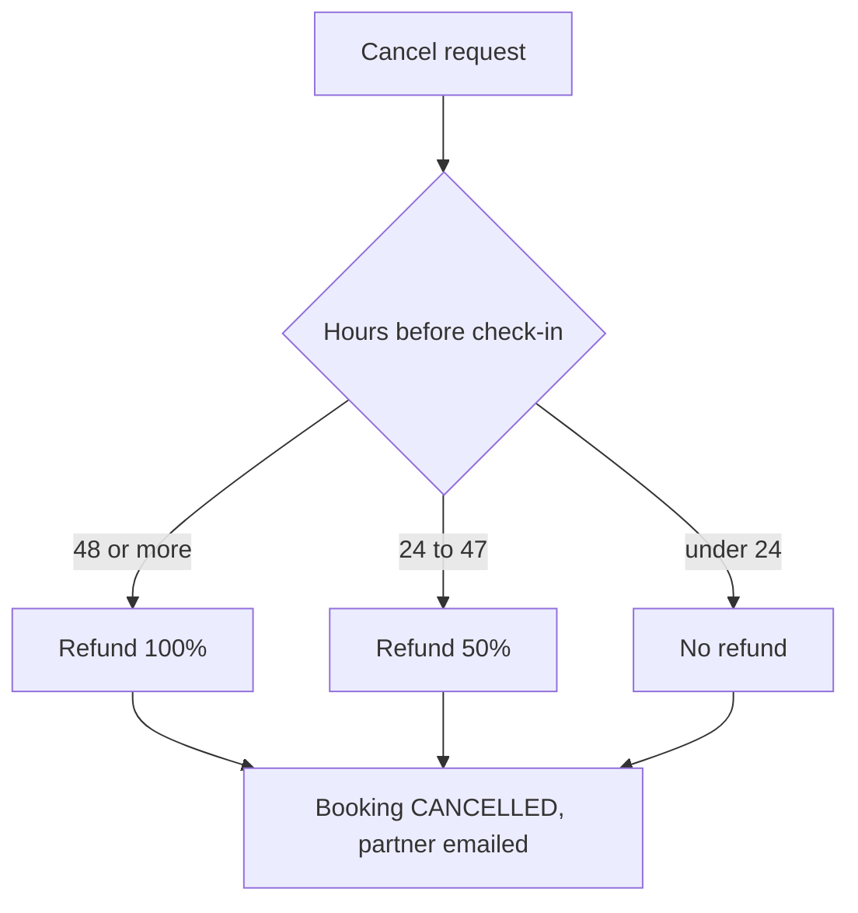

# Booking cancellation and refunds

> Source of truth for this business area, built from the code. Code version: booking-core@__COMMIT__ (__TODAY__). Status: __STATUS_LINE__.

## Summary

A guest or a partner cancels a confirmed booking. The system calculates the refund from the time left until
check-in, marks the booking cancelled and notifies the partner the booking came from by email.

## Glossary

| Term | Meaning | In code |
| --- | --- | --- |
| Refund percent | Share of the booking total returned to the guest | `CancellationPolicy` |
| Partner | The channel the booking came from | `PartnerNotifier` |

## Actors and entry points

| Actor / trigger | How it starts | Reference |
| --- | --- | --- |
| Guest or partner | `POST /bookings/{id}/cancel` | `booking-core/src/main/java/com/demo/booking/booking/BookingController.java:30` |

## Main flow

1. `BookingService.cancel` computes whole hours until check-in (`booking-core/src/main/java/com/demo/booking/booking/BookingService.java:60-71`).
2. `CancellationPolicy.refundPercent` picks the refund (`booking-core/src/main/java/com/demo/booking/booking/CancellationPolicy.java:16-24`).
3. The partner is notified by email (`booking-core/src/main/java/com/demo/booking/notification/EmailPartnerNotifier.java:22-26`).

## Business rules

| Id | Rule | Where | Reference |
| --- | --- | --- | --- |
| BR1 | 48 hours or more before check-in: 100% refund | step 2 | `booking-core/src/main/java/com/demo/booking/booking/CancellationPolicy.java:17` |
| BR2 | 24 to 47 hours: 50% refund | step 2 | `booking-core/src/main/java/com/demo/booking/booking/CancellationPolicy.java:20` |
| BR3 | Under 24 hours: no refund | step 2 | `booking-core/src/main/java/com/demo/booking/booking/CancellationPolicy.java:23` |

## Differences from Jira and Confluence

- DEMO-207 says a full refund starts at 24 hours; the code and the Confluence page "Cancellation and refund rules" say 48 hours.

## Sources

- Code: booking-core@__COMMIT__
- Jira: DEMO-207
- Confluence: Cancellation and refund rules (page 5502)
